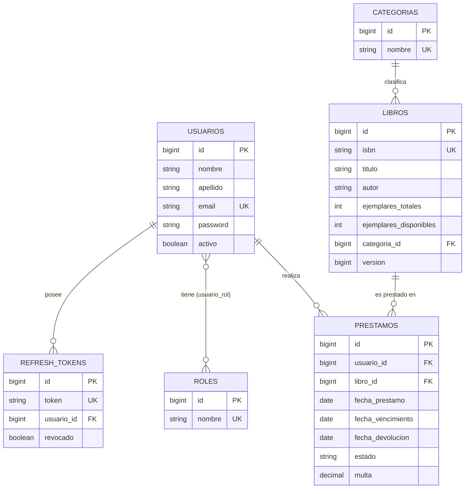

# 📚 API de Gestión de Bibliotecas Universitarias

API RESTful desarrollada con **Java 17 + Spring Boot 3** para administrar libros, usuarios, préstamos y devoluciones de una biblioteca universitaria, con **autenticación JWT sin estado** y **autorización por roles** (`ADMIN`, `USUARIO`).

> Proyecto de la unidad didáctica *Desarrollo de los Componentes del Negocio* — Escuela de Tecnología, Zegel.

**Integrantes:** _(nombre 1)_, _(nombre 2)_, _(nombre 3)_

---

## 📑 Contenido
1. [Características](#-características)
2. [Stack tecnológico](#-stack-tecnológico)
3. [Arquitectura](#-arquitectura)
4. [Modelo de datos](#-modelo-de-datos)
5. [Instalación y ejecución](#-instalación-y-ejecución)
6. [Credenciales de demostración](#-credenciales-de-demostración)
7. [Seguridad JWT y roles](#-seguridad-jwt-y-roles)
8. [Endpoints](#-endpoints)
9. [Ejemplos de entrada y salida](#-ejemplos-de-entrada-y-salida)
10. [Manejo de errores](#-manejo-de-errores)
11. [Reglas de negocio](#-reglas-de-negocio)
12. [Pruebas](#-pruebas)
13. [Estructura del proyecto](#-estructura-del-proyecto)

---

## ✨ Características
- CRUD de **libros** y **categorías**; registro de **usuarios**, **préstamos** y **devoluciones** (con cálculo automático de multa).
- Persistencia con **JPA + Hibernate + Spring Data JPA** sobre **PostgreSQL**.
- **JWT stateless**: access token (15 min) + **refresh token** rotativo y revocable (7 días) + logout.
- Filtro de seguridad personalizado y respuestas **401/403 en JSON** personalizadas.
- Control de acceso en dos capas: reglas por ruta (`SecurityConfig`) + `@PreAuthorize` en controladores.
- **Validación** con Bean Validation y **manejo centralizado de errores** (`@RestControllerAdvice`).
- Consultas personalizadas (JPQL, `Specification`, `@EntityGraph`), paginación y ordenamiento.
- Bloqueo optimista (`@Version`) para proteger el stock de ejemplares ante concurrencia.
- Documentación **Swagger/OpenAPI** + **colección Postman** con tests automáticos.
- Pruebas unitarias y de integración (JUnit 5, Mockito, MockMvc, H2).

## 🧰 Stack tecnológico
Java 17 · Spring Boot 3.3 · Spring Web · Spring Security 6 · Spring Data JPA / Hibernate 6 · PostgreSQL 16 · JJWT 0.12 · springdoc-openapi 2.6 · Lombok · Maven · Docker.

## 🏗️ Arquitectura
Arquitectura en capas con separación clara de responsabilidades:

```
Cliente (Postman / Swagger)
      │  HTTP + JWT
      ▼
 Filtro JWT ─► SecurityFilterChain ─► Controller (DTOs + @Valid + @PreAuthorize)
                                          │
                                       Service (lógica de negocio, @Transactional)
                                          │
                                     Repository (Spring Data JPA)
                                          │
                                  Entidades JPA ─► PostgreSQL
```

## 🗃️ Modelo de datos


Diagrama en imagen: [`docs/diagrama_entidades.png`](docs/diagrama_entidades.png). Las tablas se generan automáticamente con Hibernate (`ddl-auto=update`).

## 🚀 Instalación y ejecución

### Requisitos
- **JDK 17+**, **Maven 3.9+** y **Docker** (o un PostgreSQL local).

### Opción A — Base de datos con Docker + app local (recomendada para desarrollo)
```bash
git clone <URL-DEL-REPOSITORIO>
cd biblioteca-api

# 1. Levantar PostgreSQL
docker compose up -d db

# 2. Ejecutar la API
mvn spring-boot:run
```

### Opción B — Todo con Docker
```bash
docker compose up --build
```

### Opción C — PostgreSQL local sin Docker
1. Crear la base: `CREATE DATABASE biblioteca;`
2. Ajustar variables de entorno si es necesario (ver tabla) y ejecutar `mvn spring-boot:run`.

### Variables de entorno (todas opcionales; hay valores por defecto para desarrollo)
| Variable | Por defecto | Descripción |
|---|---|---|
| `DB_URL` | `jdbc:postgresql://localhost:5432/biblioteca` | URL JDBC |
| `DB_USER` / `DB_PASSWORD` | `postgres` / `postgres` | Credenciales de BD |
| `JWT_SECRET` | clave de desarrollo | Clave HMAC en **Base64** (≥ 256 bits). **Cambiar en producción** |
| `JWT_ACCESS_MINUTES` | `15` | Vigencia del access token |
| `JWT_REFRESH_DAYS` | `7` | Vigencia del refresh token |
| `PORT` | `8080` | Puerto HTTP |

Generar una clave segura: `openssl rand -base64 48`

### URLs útiles
- API: `http://localhost:8080`
- **Swagger UI:** `http://localhost:8080/swagger-ui.html`
- OpenAPI JSON: `http://localhost:8080/v3/api-docs`

## 🔑 Credenciales de demostración
Al iniciar se crean automáticamente los roles, dos usuarios y un catálogo de ejemplo:

| Rol | Email | Contraseña |
|---|---|---|
| ADMIN | `admin@biblioteca.edu` | `Admin123!` |
| USUARIO | `usuario@biblioteca.edu` | `Usuario123` |

> Para desactivar los datos de ejemplo: `app.seed.enabled=false` en `application.yml`.

## 🔐 Seguridad JWT y roles
1. `POST /api/auth/login` valida credenciales (BCrypt) y devuelve `accessToken` + `refreshToken`.
2. El cliente envía `Authorization: Bearer <accessToken>` en cada petición. **No existe sesión en el servidor** (`STATELESS`).
3. `JwtAuthenticationFilter` valida firma, expiración y tipo del token y carga los roles del token en el contexto de seguridad.
4. Al expirar el access token se usa `POST /api/auth/refresh`; el refresh token **rota** (el anterior queda revocado).
5. `POST /api/auth/logout` revoca el refresh token.

**Matriz de acceso**

| Recurso | Público | USUARIO | ADMIN |
|---|:-:|:-:|:-:|
| `/api/auth/**` (registro, login, refresh, logout) | ✅ | ✅ | ✅ |
| `GET /api/libros`, `/api/libros/{id}`, `/populares`, `GET /api/categorias` | ❌ | ✅ | ✅ |
| `POST/PUT/DELETE /api/libros`, `POST /api/categorias` | ❌ | ❌ | ✅ |
| `GET /api/usuarios/me` | ❌ | ✅ | ✅ |
| `/api/usuarios/**` (listar, crear, activar/desactivar) | ❌ | ❌ | ✅ |
| `GET /api/prestamos/mi-historial` | ❌ | ✅ | ✅ |
| `POST /api/prestamos`, `PUT /api/prestamos/{id}/devolucion`, listados y vencidos | ❌ | ❌ | ✅ |

Respuestas de seguridad: **401** (sin token / token inválido o expirado) y **403** (rol insuficiente), ambas en JSON con el formato `ApiError`.

## 📡 Endpoints
| Método | Ruta | Rol | Descripción |
|---|---|---|---|
| POST | `/api/auth/registro` | Público | Registra un usuario (rol USUARIO) |
| POST | `/api/auth/login` | Público | Login, devuelve tokens |
| POST | `/api/auth/refresh` | Público | Renueva tokens (rotación) |
| POST | `/api/auth/logout` | Público | Revoca el refresh token |
| GET | `/api/libros` | Autenticado | Búsqueda: `titulo`, `autor`, `categoriaId`, `soloDisponibles`, `page`, `size`, `sort` |
| GET | `/api/libros/{id}` | Autenticado | Detalle de libro |
| GET | `/api/libros/populares?limite=5` | Autenticado | Ranking de libros más prestados |
| POST | `/api/libros` | ADMIN | Registra libro |
| PUT | `/api/libros/{id}` | ADMIN | Actualiza libro |
| DELETE | `/api/libros/{id}` | ADMIN | Elimina libro sin historial |
| GET | `/api/categorias` | Autenticado | Lista categorías |
| POST | `/api/categorias` | ADMIN | Crea categoría |
| GET | `/api/usuarios/me` | Autenticado | Perfil propio |
| GET | `/api/usuarios` | ADMIN | Lista usuarios (paginado) |
| POST | `/api/usuarios` | ADMIN | Crea usuario con roles |
| PATCH | `/api/usuarios/{id}/estado?activo=false` | ADMIN | Activa/desactiva cuenta |
| POST | `/api/prestamos` | ADMIN | Registra préstamo |
| PUT | `/api/prestamos/{id}/devolucion` | ADMIN | Registra devolución y multa |
| GET | `/api/prestamos?estado=ACTIVO` | ADMIN | Lista préstamos |
| GET | `/api/prestamos/vencidos` | ADMIN | Préstamos vencidos sin devolver |
| GET | `/api/prestamos/usuario/{id}` | ADMIN | Historial de un usuario |
| GET | `/api/prestamos/mi-historial` | Autenticado | Historial propio |

## 🧪 Ejemplos de entrada y salida

**Login** — `POST /api/auth/login`
```json
{ "email": "admin@biblioteca.edu", "password": "Admin123!" }
```
```json
{
  "accessToken": "eyJhbGciOiJIUzM4NCJ9...",
  "refreshToken": "9f1c0e7a5b...",
  "tipo": "Bearer",
  "expiraEnSegundos": 900,
  "email": "admin@biblioteca.edu",
  "roles": ["ADMIN"]
}
```

**Crear libro (ADMIN)** — `POST /api/libros`
```json
{
  "isbn": "9780321125217",
  "titulo": "Domain-Driven Design",
  "autor": "Eric Evans",
  "anioPublicacion": 2003,
  "categoriaId": 1,
  "ejemplaresTotales": 3
}
```
```json
{
  "id": 5, "isbn": "9780321125217", "titulo": "Domain-Driven Design", "autor": "Eric Evans",
  "anioPublicacion": 2003, "categoriaId": 1, "categoria": "Ingeniería de Software",
  "ejemplaresTotales": 3, "ejemplaresDisponibles": 3
}
```

**Registrar préstamo (ADMIN)** — `POST /api/prestamos`
```json
{ "usuarioId": 2, "libroId": 5, "diasPrestamo": 7 }
```
```json
{
  "id": 1, "usuarioId": 2, "usuario": "Usuario Demo", "libroId": 5, "libro": "Domain-Driven Design",
  "fechaPrestamo": "2026-11-23", "fechaVencimiento": "2026-11-30", "fechaDevolucion": null,
  "estado": "ACTIVO", "multa": 0, "vencido": false
}
```

**Error de validación (400)**
```json
{
  "timestamp": "2026-11-23T21:15:03.114",
  "status": 400,
  "error": "Bad Request",
  "mensaje": "Los datos enviados no son válidos",
  "ruta": "/api/libros",
  "errores": [
    { "campo": "isbn", "mensaje": "El ISBN debe tener 10 o 13 dígitos numéricos" },
    { "campo": "ejemplaresTotales", "mensaje": "Debe existir al menos 1 ejemplar" }
  ]
}
```

## ⚠️ Manejo de errores
Todas las respuestas de error usan el mismo formato (`ApiError`):

| Código | Causa |
|---|---|
| 400 | Validación fallida, JSON mal formado, parámetro inválido |
| 401 | Sin token, token inválido/expirado, credenciales incorrectas, refresh token revocado |
| 403 | Rol insuficiente o cuenta desactivada |
| 404 | Recurso inexistente |
| 405 | Método HTTP no permitido |
| 409 | Duplicados (email, ISBN), reglas de negocio, conflicto de concurrencia, integridad referencial |
| 500 | Error interno (sin exponer detalles técnicos) |

## 📏 Reglas de negocio
- Un préstamo requiere libro con ejemplares disponibles y usuario activo.
- Máximo **3 préstamos activos** por usuario; no se puede prestar dos veces el mismo libro al mismo usuario.
- No se presta a usuarios con préstamos **vencidos** pendientes.
- Duración del préstamo: 1 a 30 días.
- Devolución: repone el stock y calcula **multa = días de retraso × 1.00**.
- No se elimina un libro con historial de préstamos; no se reduce el stock por debajo de los ejemplares prestados.

## ✅ Pruebas

### Automatizadas (Maven)
```bash
mvn test
```
- `JwtServiceTest`: generación, manipulación y expiración de tokens.
- `PrestamoServiceTest`: stock, vencimiento, multa y devolución doble (Mockito).
- `SecurityIntegrationTest`: 401/403/200/201/400/409 contra H2 en memoria (MockMvc).

### Postman
1. Importar `postman/Biblioteca_API.postman_collection.json`.
2. Con la API en ejecución, abrir **Collection Runner** y ejecutar la colección completa **en orden** (6 carpetas, 38 peticiones con tests automáticos).
3. La variable `baseUrl` es `http://localhost:8080`; los tokens e ids se guardan solos entre peticiones.

## 🗂️ Estructura del proyecto
```
src/main/java/com/biblioteca
├── config/        SecurityConfig, OpenApiConfig, DataInitializer
├── security/      JwtService, JwtAuthenticationFilter, EntryPoint/AccessDenied, UserDetailsService
├── controller/    Auth, Libro, Categoria, Usuario, Prestamo
├── service/       Lógica de negocio transaccional
├── repository/    Spring Data JPA (Specification, JPQL, EntityGraph)
├── model/         Entidades JPA y enums
├── dto/           Requests/Responses con validaciones
└── exception/     Excepciones de dominio + GlobalExceptionHandler
postman/           Colección con tests
docs/              Diagrama de entidades
```
